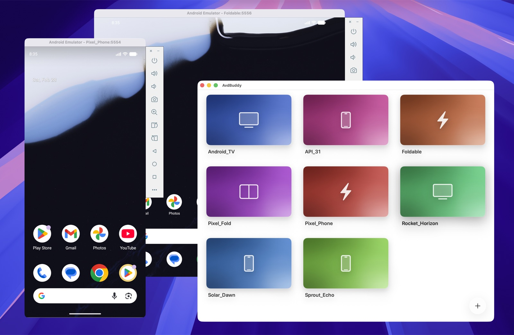

# AvdBuddy



AvdBuddy is a native macOS app for managing Android Virtual Devices without going through Android Studio.

It focuses on the common emulator workflow:
- browse your existing AVDs from a visual home screen
- launch an emulator with a double click
- create new AVDs through a guided wizard
- duplicate, rename, and delete AVDs
- download Android system images from Google when needed

## What It Does

AvdBuddy reads the Android SDK and local AVD setup on your Mac, then gives you a faster UI for:
- viewing all AVDs in one place
- distinguishing them visually with stable per-device gradients
- creating phones, tablets, foldables, TVs, and Wear OS emulators
- selecting Android versions, variants, architecture, storage, RAM, SD card, and Google Play services options

## Requirements

To build and run AvdBuddy from source, you need:
- macOS
- Xcode with command line tools (`xcodebuild`)

To use AvdBuddy with Android emulators, you also need:
- Android SDK command-line tools
- `avdmanager`
- `sdkmanager`
- Android Emulator
- `adb`

It looks for the SDK in:
- `ANDROID_SDK_ROOT`
- `ANDROID_HOME`
- `~/Library/Android/sdk`

AVD storage defaults to `~/.android/avd` (or your Android environment override).
Use the toolbar's Settings button to choose a different emulator storage folder,
including a folder on an external SSD. The selection is remembered and used for
browsing, creating, launching, duplicating, renaming, deleting, and revealing devices
in Finder. Switching folders does not move existing devices or change Android Studio's
settings. Select a folder containing the `.ini` and `.avd` files, or create an empty
folder using Browse to store new devices there.

System images are managed separately under the selected SDK's `system-images`
folder. Settings shows their actual location, including symlink destinations, and
flags unavailable storage. Changing the AVD folder does not relocate system images.
External storage must be connected before using devices or images stored there.

## Installation

You can install AvdBuddy in either of these ways:

### Download from GitHub Releases

Download the latest macOS DMG from [GitHub Releases](https://github.com/alexstyl/avdbuddy/releases), then open `AvdBuddy.app` from `/Applications`.

### Install with Homebrew

Install directly from the shared tap:

```bash
brew install --cask alexstyl/tap/avdbuddy
```

Or tap first, then install:

```bash
brew tap alexstyl/tap
brew install --cask avdbuddy
```

Homebrew installs `AvdBuddy.app` into `/Applications`.

## Development

Run the test suite:

```bash
xcodebuild -project AvdBuddy.xcodeproj -scheme AvdBuddy -destination 'platform=macOS' test
```

Run the project with the provided macOS script. It builds the `AvdBuddy` scheme in `Debug` and launches the app:

```bash
./scripts/runMac
```

## Homebrew Packaging

AvdBuddy can be distributed as a Homebrew cask from a shared tap repository. Homebrew installs `AvdBuddy.app` into `/Applications`. The app still requires Android SDK tools on the machine in order to manage emulators.

To publish a Homebrew release:
- build and notarize the macOS DMG with `./scripts/releaseMac`
- upload the versioned artifact, for example `AvdBuddy-0.3.0.dmg`, to GitHub Releases
- update the Homebrew cask in your shared tap repo, for example `alexstyl/homebrew-tap`, with the new `version` and `sha256`

The cask source for the tap is included in [`packaging/homebrew/avdbuddy.rb`](./packaging/homebrew/avdbuddy.rb). A short setup guide lives in [`packaging/homebrew/README.md`](./packaging/homebrew/README.md).

## Credits

Inspired by [VirtualBuddy](https://github.com/insidegui/VirtualBuddy).

## License

[MIT](./LICENSE) • Alex Styl ([alexstyl](https://x.com/alexstyl))
